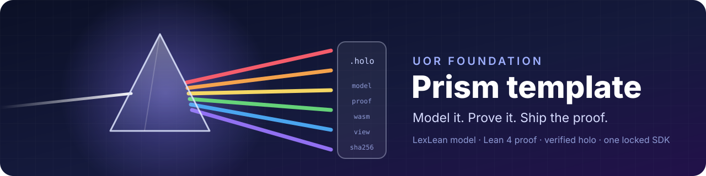

<a id="top"></a>

<p align="center">
  
</p>

# Hologram Forge

<p align="center">
  <a href="https://uor-foundation.github.io/forge/">Open Forge</a> &nbsp;|&nbsp; <a href="openspec/specs/forge-kernel/spec.md">Spec</a> &nbsp;|&nbsp; <a href="CONFORMANCE.md">Conformance</a> &nbsp;|&nbsp; <a href="AGENTS.md">For AI agents</a> &nbsp;|&nbsp; <a href="https://discord.gg/ZwuZaNyuve">Community</a>
</p>

<p align="center">
  <a href="https://uor-foundation.github.io/forge/"></a>
  <a href="app/src/ForgeKernelProofs.lex.tex"></a>
  <a href="https://github.com/UOR-Foundation/forge/actions/workflows/bootstrap.yml"></a>
  <a href="https://discord.gg/ZwuZaNyuve"></a>
  <a href="LICENSE-MIT"></a>
</p>

> **Describe an app. Get one you can prove.**
>
> Forge turns a sentence into a working app, and never calls it done until the proof says so.

Building with AI is fast, but you can't tell whether the result does what you asked. Forge closes that gap. You describe the app, Forge writes its rules, checks them, proves them in Lean, and only then lets you publish. Change one rule and the proof is reset, so the badge you see is always about the app you have.

This repository is Forge's kernel: the small, proved core that decides when an app may move forward and what it is allowed to touch.

<p align="right">(<a href="#top">back to top</a>)</p>

## Open it

```
Open https://uor-foundation.github.io/forge/ in any modern browser.
```

The page loads the kernel, verifies its bytes, replays its examples, and runs it, all in your browser. Type `drafting check` and it answers `checked`.

Prefer a terminal? [](https://codespaces.new/UOR-Foundation/forge?devcontainer_path=.devcontainer/try/devcontainer.json)

<p align="right">(<a href="#top">back to top</a>)</p>

## How an app moves

Every Forge app walks one path. The kernel decides each step.

| Phase | What happens | What moves it on |
|---|---|---|
| **Drafting** | You describe the app and edit its rules | `check` |
| **Checked** | The rules are complete and consistent | `approve` |
| **Proving** | Lean proves every promise the app makes | `attest`, or `fail` back to checked |
| **Proved** | The proof matches the current rules | `publish` |
| **Published** | Anyone can open, verify and run it | `edit` starts over |

Any edit sends the app back to drafting, from any phase. A proof never outlives the rules it was about.

<p align="right">(<a href="#top">back to top</a>)</p>

## What Forge promises

These are not goals. Lean proves each one for every possible request.

| Promise | ID |
|---|---|
| Never says proved without an attestation | FK-01 |
| Never publishes an unproved app | FK-02 |
| Every edit resets to drafting | FK-03 |
| Never proves rules that skipped the check | FK-04 |
| With no grant, only Forge itself may act | FK-05 |
| With no grant, nothing reaches the network | FK-06 |
| A denial always wins | FK-07 |
| A preview or published app needs an explicit grant | FK-08 |
| A preview never fetches without a grant | FK-09 |

The capability gate answers `allow` or `deny`. Ask it with `gate ORIGIN EFFECT RECORD GRANTED DENIED`. It denies by default.

<p align="right">(<a href="#top">back to top</a>)</p>

## You don't trust it. You verify it.

Forge ships as a holo: one file holding the model, the proof, the compiled app, and how it was built. It is named by its own contents, so a single changed byte changes the name. Check it yourself, offline:

```bash
npx prism-code inspect app/.prism/build/*/*.holo
```

The live page runs the same checks before it shows you anything: authentic bytes, a Lean proof, and every example giving its proved answer. Green only when all three pass.

<p align="right">(<a href="#top">back to top</a>)</p>

## How it works

You never need this to use Forge. It is here for the curious.

| Layer | In plain words | Where |
|---|---|---|
| Model | The rules, written once | [`app/src/ForgeKernel.lex.tex`](app/src/ForgeKernel.lex.tex) |
| Proof | Why the promises always hold | [`app/src/ForgeKernelProofs.lex.tex`](app/src/ForgeKernelProofs.lex.tex) |
| Claims | Every promise, registered once | [`model/`](model/) |
| Scenarios | Each promise as a readable example | [`features/suites/`](features/suites/) |
| Page | The browser app that verifies and runs it | [`site/`](site/) |

Words this README uses:

* **Lean** is a language whose checker proves code correct.
* **LexLean** is the readable language the rules are written in.
* **Holo** is a self-verifying app in one file.
* **Attestation** is a signed record that a proof passed.
* **Grant** is your explicit permission for one effect.

<p align="right">(<a href="#top">back to top</a>)</p>

## The usual app builder, and this one

| | The usual app builder | Forge |
|---|---|---|
| You describe | An app | An app |
| You get | Code that probably works | Rules proved for every input |
| "Done" means | It looked right | Lean said so |
| After an edit | Hope nothing broke | The proof resets until re-proved |
| Network access | Whatever the code does | Denied until you grant it |
| Why you trust it | Because it ran once | Because you can verify it |

<p align="right">(<a href="#top">back to top</a>)</p>

## Build from source

You need Git, Docker with Buildx, and a devcontainer client. Nothing else goes on your machine.

```bash
git clone https://github.com/UOR-Foundation/forge
cd forge
# open in the devcontainer, then:
just vv      # the whole gate: format, model, lint, tests, audits, proved build
just app     # build and verify the holo only
```

No Docker? Push a commit. [`build.yml`](.github/workflows/build.yml) builds on GitHub and hands back a signed holo, which you verify rather than trust:

```bash
npx prism-code build --remote github
```

| Command | What it does |
|---|---|
| `just vv` | The whole gate, the same locally and in CI |
| `just app` | Build and verify the holo |
| `just new-capability <ID> <level> <suite> "<statement>"` | Register a new promise with its scenario and failing test |
| `just model-write` | Regenerate `CONFORMANCE.md` |
| `just fmt` | Format the workspace |

<p align="right">(<a href="#top">back to top</a>)</p>

## Contributing

One rule makes contributing simple: **a change is done when it can prove itself.**

1. Read [AGENTS.md](AGENTS.md). It is short and holds the six rules.
2. Add a promise with `just new-capability`. It writes the claim, the scenario and a failing test.
3. Make the test pass, then plant the bug it exists to catch and watch it fail.
4. Run `just vv` until it is green.
5. Open a pull request that says, in plain words, why the change matters.

Every gate failure names the rule it broke, so a red build tells you what to fix.

<p align="right">(<a href="#top">back to top</a>)</p>

## Documentation

| Document | What is inside |
|---|---|
| [Spec](openspec/specs/forge-kernel/spec.md) | Every promise, with its reason and example |
| [Conformance](CONFORMANCE.md) | The generated list of claims and their status |
| [Agent rules](AGENTS.md) | Rules R1 to R6 and the order of work |
| [Verification](VERIFICATION.md) | What the gate accepts and why |
| [Template contract](TEMPLATE-CONTRACT.md) | The policy files this repository inherits and must not edit |
| [Identity](identity/README.md) | Passkey sign-in with no server to trust |

<p align="right">(<a href="#top">back to top</a>)</p>

## Community

* Join the [Discord](https://discord.gg/ZwuZaNyuve).
* Questions and ideas are welcome in GitHub issues and discussions.
* Learn about the foundation behind it at the [UOR Foundation](https://uor.foundation/).

<p align="right">(<a href="#top">back to top</a>)</p>

## Acknowledgments

Forge is built with [PrismPM](https://github.com/UOR-Foundation/PrismPM), [LexLean](https://github.com/UOR-Foundation/LexLean) and [prism-code](https://www.npmjs.com/package/prism-code), on the work of the **[UOR Foundation](https://uor.foundation/)** and its community. It opens in the same frame as [Hologram OS](https://github.com/Hologram-Technologies/hologram-os).

<p align="right">(<a href="#top">back to top</a>)</p>

## License

Licensed under [MIT](LICENSE-MIT) or [Apache-2.0](LICENSE-APACHE).

---

<p align="center"><i>Describe it. Prove it. Share it.</i></p>

<p align="right">(<a href="#top">back to top</a>)</p>
